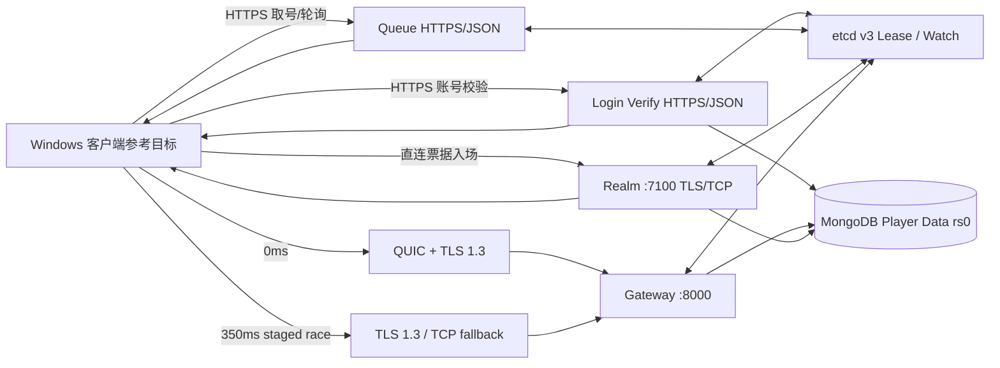
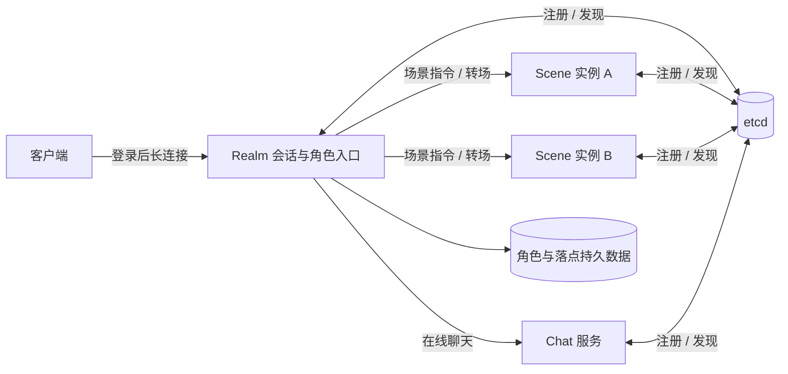
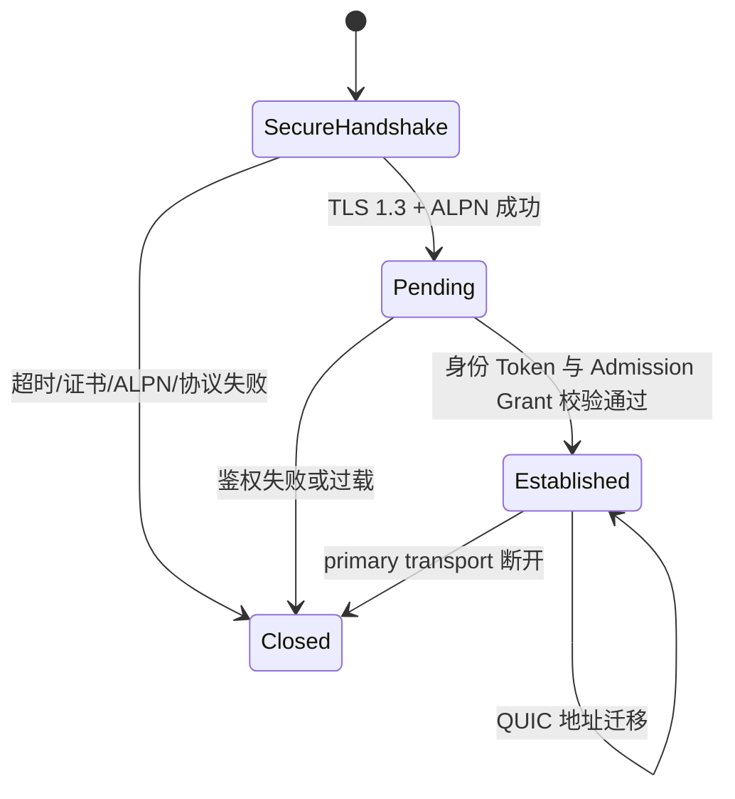
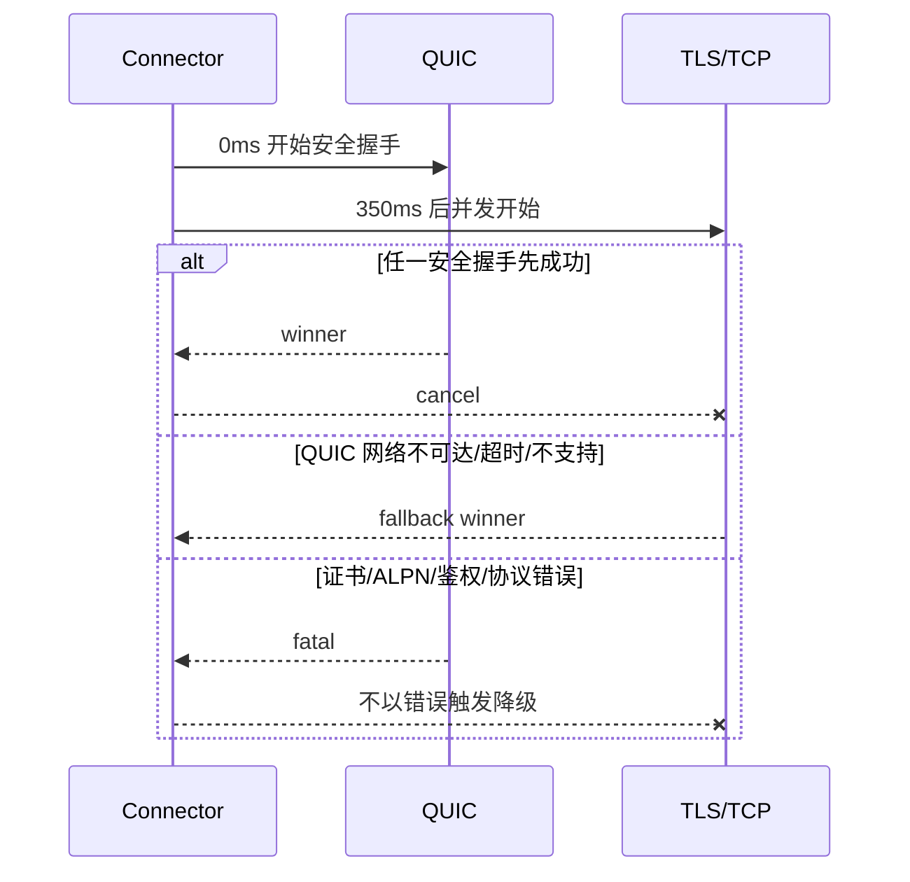
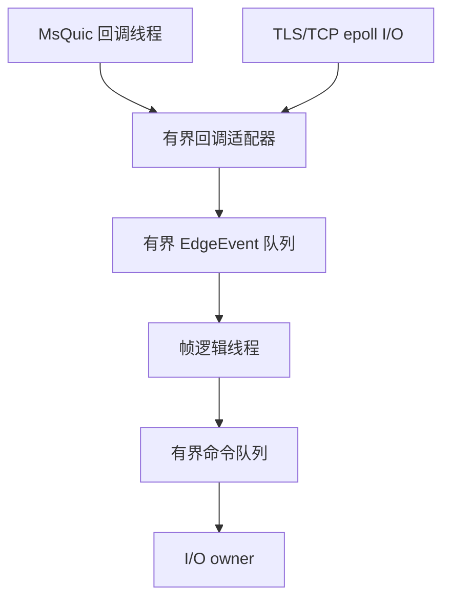

# RealmMesh 接入架构

## 服务拓扑

LoginVerify 是登录链路第一站(无状态 HTTPS JSON 服务,#41):校验账号后签发身份
Token。验签(Argon2 + 账号源查询)不在 poll 线程执行:`LoginVerifyDispatcher` 把
`POST /v1/login/verify` 交给有界工作者(`verify_workers`/`verify_capacity`),
`HttpServer` 挂起该响应、工作者完成后由属主线程补发;满额即回 `503` + `Retry-After`
(code `1005`,客户端退避后重验),`/healthz` 与 JWKS 仍在 loop 线程即时应答(#98,ADR-0007 补记)。Queue 负责取号与放行(#42),放行时另外签发与身份绑定的 Admission Grant。
Queue 在返回 `202` 前，用一笔 etcd 事务同时提交 `identity_jti → Queue Number` 映射与
递增后的队列快照；响应不确定时先回读同一权威存储。同一未过期身份重试恢复原号，
存储不可用则返回可重试错误而不承认号码。映射随身份过期租约回收，轮询仍不建立
逐客户端会话状态。
客户端带身份 Token 与 Admission Grant attach 到 Gateway,Gateway 从权威玩家数据源重新
检查账号准入状态后，下发只绑定账号与 Realm 的直连票据与候选端点；Realm 单次兑换票据
后完成入场，进入选角阶段，角色的列出、创建与选择都在 Realm Session 里完成（#93）。
候选端点含主机名、数字端口、
协议与优先级,不依赖客户端隐式约定。排队号牌只用于位次查询与找回,网关不接受它。

## Scene 逐步业务拓扑（S1–S5）

阶段 4 的逐步交付契约见 [Scene 参考业务规格](specs/2026-10-17-scene-reference-loop.md)。
首个闭环为一个独立 Scene 进程承载一个分片、两个角色移动互相可见；随后才实现双实例
转场、动态加入与排空、完整故障验收。S2（#162）已实现单分片进入与移动互见；S3（#163）已实现静态双实例转场与归属恢复，S4（#164）已实现动态加入、承载 CAS、同分片重建与排空，S5（#165、PR #174）已完成并合并，冻结源码的[最终验收记录](research/scene-s5-acceptance-2026-10-23.md)保留双平台全量与各三次完整Scene证据。
S1（#161）已在 `proto` 定义客户端与内部 Scene 线契约、在 `game/common` 提供严格编解码，
并让既有 `MongoPlayerDataStore` 实现窄 `RealmSceneStore`：独立 `character_scenes` 记录以
角色为键，majority/journal 条件写同时提交归属、落点与最后幂等结果。驱动继续私有，复用
原连接池与自动化隔离副本集；测试命令只在独占的确认失败注入副本集中启用。入口注册表现有五个真实服务，新增 `game/scene` 的 `SceneModule`，静态模式持有单分片 `SceneShard`，
通过独立 mTLS EdgeRuntime 接收内部消息，配置分片 1 或 2。Realm 的 RealmScenes 编排线程
通过私有协程等待 future，每个实例持有独立的有界 TLS IO 执行器；场景数据使用惰性启动的
四线程有界池，复用既有 BoundedWorkPool，与训练池隔离。线程只完成 future，状态迁移均在
编排线程恢复；每角色（含旧、新 Realm Session）串行处理指令，实例间不会互相等待。
停机先结算已发出的场景写，每会话只尝试一次持久清理，不再续发移除重试；在途调用沿用
原截止，随后关闭实例链路让 Scene 回收成员。数据库故障时保留已确认落点与旧归属事实，
由新 Realm incarnation 重新绑定，不以无限清理重试阻塞进程退出。
每实例至多 64 个指令（含排队、执行和未收结果），会话 1+8；最多两个实例、128 条编排记录、
1024 条客户端输出和 1024 条内部推送，数据池上限 256，内部操作与排队总截止均为三秒。
Realm Session 关闭先使场景绑定失效，再按旧版本异步撤销；
激活失败保留已提交事实，按同一指令恢复，不返回“确定未提交”。客户端经独立窄接口
`SceneSession` 复用现有 Login Chain，心跳/训练等待期间有界缓存 Scene 推送。

Realm 对 `scene` 声明可选发现依赖，不设置启动等待；发现只选端点，服务 CA 与精确 DNS SAN
允许列表完成身份校验。静态模式初次仅以 `SNAPSHOT + scene_incarnation=discover` 探测已认证服务的
运行 incarnation，之后每个请求严格校验；此探测不能执行角色变更。默认四服务登录拓扑仍可
独立运行，Scene 通过显式配置启用；完整 Scene 验收使用独立 Realm、两个 Scene 和入口组进程。Resolver 按明确 instance_id 返回
端点，不用全局权重替代角色绑定目标；发现仍不能授予归属。服务端目标允许列表配置目标落点，
转场先准备 B，再用 MongoDB CAS 提交新版本/落点/结果，B 激活并交付快照；A 的条件移除独立
重试，不阻塞 B 的移动。目标提交后的恢复不回滚 A，Realm/Scene 重启后读取最后序号及落点，
用下一 EnterScene 序号取得新版本；旧版本持久写与旧实例事件均被拒绝。
SIGKILL 后同名进程需等旧注册租约失效再注册；不抢占仍有效的注册。

动态模式将逻辑分片与实例 IO 槽分开：Realm 仍只维护至多两个独立 Peer，分片 1/2 可以由
同一个实例承载。发现完整快照、mTLS 精确身份与 `STATUS` 业务就绪共同决定候选；已活跃
承载不自动重平衡。`ServiceResolver::endpoints()` 仅拷贝完整已交付缓存，初始化失败或
差分发布中返回未知，避免把临时空列表当成故障；帧线程不执行网络查询。端点变化使 Peer
关闭旧连接并重新认证本次 incarnation。只在旧注册消失或已认证新 incarnation 后恢复承载。

`MongoPlayerDataStore` 的窄 `SceneShardStore` 管理 `scene_shards` 与 `scene_instances`。
Scene 在宿主注册成功的 `started()` 边界发布业务 incarnation；之后数据库访问由独立的
四线程、64 容量工作池执行，每条 mTLS 连接至多排队八条请求，校验结果回到 Scene 帧。
Scene 按稳定 shard_id 持有至多两个状态机；角色 Route 带承载版本，分片事件 incarnation
由进程 incarnation 与承载版本组成。相同物理实例的两个分片不混用快照或事件水位。

分配事务先匹配未排空实例的 incarnation 并写接纳栅栏，再 CAS 分片记录。实例排空事务同时
关闭该实例接纳并标记其全部分片；与分配写冲突，不能在排空完成后落入新分片。承载版本只在
更换或释放时递增。动态角色提交在同一事务中匹配并写分片栅栏与角色条件更新；只有快照读
不足以防止承载变化与旧写之间的写偏斜。公共头仍不含驱动，服务之间不相互链接。

排空控制复用专用 mTLS 允许的 Realm 服务身份，`realm_mesh_scene_control` 提供状态、尝试
标识与截止。Realm 逐角色以 S3 转场消耗下一场景序号，保留客户端原先已派发的写结算顺序；
提交后目标恢复和源条件移除都计入未完工作。目标无容量时保持源分片服务并报告未完成，截止
后标记失败，重复尝试不重置截止。确认成员/准备清空、无在途写及未完迁出后才释放分片。
完成后实例业务停用，管理端点与发现注册保留供核对，再由运维停止进程；不会提前注销伪造完成。

## 目标业务拓扑（规划中）

以下是 [README 必做路线图](../README.md#必做路线图) 的目标边界，不是当前运行拓扑。
客户端完成现有登录链后保持与 Realm 的长连接；Realm 负责会话、角色入口和业务消息路由，
Scene 实例负责权威场景状态，Chat 实例负责场景内与跨场景的在线消息路由。Gateway
仍只负责登录，不中转业务流量。

`scene` 是已接入的服务身份，支持分片1/2动态承载、同分片重建与排空；
场景或地图本身不是新的服务身份。Realm 需要为角色确定唯一场景归属，在跨实例转场、
Scene 实例动态加入与排空时保持路由一致。两个玩家在同一场景移动时应互相看到状态；
Scene 故障不能拖垮其他场景，受影响玩家可以重新入场并恢复已确认的角色落点。
Chat 作为独立身份提供场景内及跨场景频道，保证在线同频道消息顺序与失败反馈；
Chat 故障不阻断场景业务。聊天记录与离线补投不在已承诺范围内。
阶段5的[Chat规格](specs/2026-10-23-chat-reference-loop.md)按C1–C5推进；C1（#176）已在
`proto/realmmesh/chat/v1/chat.proto`定义客户端1701–1706与内部1801–1803，
`game/common/chat_protocol`负责严格编解码，`chat_limits.hpp`只暴露轻量资源常量与计数/字节
预留检查。内部与客户端编号白名单独立，不添加framework依赖、Chat服务注册、配置或监听；
C2排序者及C3 Realm/客户端接线尚未实现，C1的结构校验不代替认证、权限与幂等状态机。
规格由Realm派生成员资格，每频道静态指定一个Chat排序者；Chat轮次内的在线受理不等于持久
送达，重启/缺口显式重新加入，转场不等待Chat。依据见[ADR-0016](adr/0016-chat-online-channel-order-and-receipt.md)。

Scene 首版的设计由 Scene 判定移动、Realm 条件持久写入 MongoDB 后确认及广播；
角色场景归属、已确认落点与场景指令幂等结果同文档原子推进。转场与重绑更新归属版本，
旧实例和旧会话的迟到结果不能覆盖新归属。Scene 不直接写角色资料，训练写入不覆盖
场景记录；暂不引入 Redis，理由及对 ADR-0011 的修订见
[ADR-0015](adr/0015-scene-confirmed-location-and-binding.md)。Realm 与 Scene 的内部链路
使用独立 TLS/TCP 监听、双向服务身份校验及 `realmmesh-scene/1`；客户端继续只连 Realm。

六种目标服务身份（现有五种与计划新增的 `chat`）都应能独立进程部署和扩容，
开发环境可同机合并运行。账号、角色和落点的持久数据由对应业务边界持有并复用存储接口，
不预设通用 `storage` 服务。Scene/Chat 参考业务的必做验收限定在本机多进程；既有
Linux 跨机器 M1–M4 验收只针对登录链接入，不作为新业务链的跨机器验证。

## Gateway 建连与会话

`framework/edge` 的 `EdgeConnectionTable` 以单一 id 空间(`EdgeConnectionId`)记录每条
Edge Connection 的唯一 primary transport 与阶段(pending/established);网关的 Edge Session
与 Realm 的 Realm Session 都沿用所绑定连接的 `EdgeConnectionId`。QUIC 和 TLS/TCP 是初次
连接时的二选一候选，不是一条连接里的双通道。当前没有恢复 token、序列号或重放窗口，因此
已建立连接中断不会透明迁移到另一传输。

`EnterRealmGranted.enter_realm_ticket` 只在 Realm 一处单次消费(重放防护):兑换
成功响应与入场(进入已认证会话态)由同一个 I/O 命令完成,重放或无效票据按鉴权
失败处理并断开。
兑换只校验票据,不读玩家数据:兑换成功即回 `EnterRealmAccepted`,会话交给
`game::realm::RealmSessions`(#93)。Realm Session 单向经历选角 → 游戏中两个阶段:
选角阶段只受理角色列表、创建与选择,选定后进入游戏中,只受理训练;阶段不符回
`3003`,会话保留。在线表按账号唯一,同账号新会话入场时,旧会话收到
`RealmSessionDisplaced`(1409)后关闭,其在途写仍会落库、回包丢弃。
角色数据访问(`RealmCharacterStore`)在有界工作者上执行,不阻塞 Realm 帧,同一会话的
请求按到达顺序逐个处理;工作者在途数或单会话未决数达上限回 `429` 加
`retry_after_seconds`,数据源故障或训练规则运行时出错回 `3010`,会话都保留。训练规则是 Lua 脚本
(`realm.training_rule_file`,默认 `configs/services/realm/training.lua`),启动时加载并
以经验 0 试调,失败即启动失败、不热更;训练按会话递增序号幂等写入(`seq == last + 1` 写,
`seq == last` 回放上次结果,其余回 `3009`)。Realm 必须配置 `player_data.uri`,
缺少角色存储即拒绝构造。消息与错误码见[协议](protocol.md#realm-session-业务)。

Gateway 的业务帧不再编排 attach、拉取、重试与 Handoff 的分步 helper。每帧只取得
当前 Realm 端点并调用一次 `GatewayLoginPipeline::advance`;该管线是
`pending → fetching → handed-off` 阶段、Admission Grant 验证与按 `identity_jti` 的
集群单次消费、连接/拉取额度、账号拉取结算、直连票据、收尾与指标的唯一权威。`EdgeRuntimePrimaryTransport` 把真实
runtime 事件/命令接入管线；生产装配使用有界异步 `PlayerDataAccountFetchPort`，查询在
`fetch_workers` 个工作线程上并发完成，提交满载时背压；单次拉取超过 `fetch_timeout_ms`
即按失败结算（迟到结果丢弃）。账号不具备准入资格（封禁、白名单外）直接以
终态 `1007` 拒绝、不重试；数据源不可用按管线策略重试，耗尽后以 `1008` 加
`retry_after_seconds` 拒绝，Admission Grant 已消费，客户端退避后重走 Login Verifier
（#98）。结果按低基数上报。延迟实现只用于
未配置数据源的隔离测试。

权威玩家数据源由 [ADR-0011](adr/0011-mongodb-authoritative-player-data.md) 定为
MongoDB 副本集（开发与 CI 为单节点 `rs0`），取代 ADR-0010 的 SQLite。`MongoPlayerDataStore`
同时实现 `AccountStore`、`PlayerDataReader` 与 Realm 的 `RealmCharacterStore`：准入事实
与角色写入以 `writeConcern: majority, j: true` 同步写入，读取使用 `readConcern: majority`，
登录链两处读取（认证、Gateway 复核）与 Realm 的角色读写都直达数据库、不经缓存。角色名
在同一 Realm 内由唯一索引保证不重复，每账号角色数上限在事务内判定，训练序号以
`last_training_seq == seq - 1` 为条件原子推进。选择角色先核对归属、再单写账号的「上次所选」，
不开事务——这偏离 ADR-0011「选择角色在事务内完成」的表述：角色既不删除也不改派，
归属一经确认，随后的单文档写没有竞态窗口。任一服务首次连到尚未导入的库时，在事务内一次性导入
`configs/common/accounts.lua`，多个服务同时启动也只有一个导入成功；之后账号口令（Argon2
哈希）、封禁/白名单、角色与上次所选角色都只以数据库为准。找不到可写 primary 或单次读写超过
`player_data` 中的超时上限，即按数据源不可用失败。开发拓扑无认证、明文且只监听本机，
跨机器暴露前须交付 TLS 与认证。

手动跨机器开发另提供共享临时库：服务器仅监听回环地址，启用 TLS 与数据库认证，
开发机经 SSH 隧道连接单节点 `rs0`。`player_data.uri_environment` 在 C++ 解析边界
读取私有环境变量，覆盖默认本机 URI；凭据与 CA 保存在仓库外的用户配置目录，
`with-shared-mongodb.sh` 加载它们并按需建隧道。自动化测试保持独立临时库。
共享开发数据允许清空重建，不配置定时备份；操作见[共享库说明](operations/shared-mongodb.md)。

宿主在 listener 启动前完成配置校验、签名材料加载、两个生产 adapter 与管线构造。
管线依赖停止时,该帧先发布零连接/零拉取的不可用额度,再停止 Gateway runtime 并撤销
就绪状态;没有 feature flag、兼容选择器或第二条登录执行路径。

## 客户端竞速

握手上限 3 秒，整轮上限 5 秒。仅 QUIC 网络不可达和超时写入 5 分钟负缓存；网络
变化立即清空。0-RTT 关闭，连接竞速期间不发送业务票据。

## 线程边界

MsQuic 自有调度不会直接调用业务逻辑。回调只完成长度帧组装并发布统一事件；队列满
时关闭可靠连接。鉴权成功响应与 pending→established 迁移由同一个 I/O 命令
(`try_accept`)完成，避免发送成功但迁移失败的半状态；decline/close 与 accept
失败等本地终结由 runtime 合成恰好一次 SessionClosed 事件，不依赖传输层上报。

## 安全与资源限制

- TLS 1.3 only，ALPN 固定 `realmmesh-edge/1`，服务端认证，无 mTLS。
- QUIC：一个客户端双向流、零单向流、无 Datagram、无 0-RTT、无恢复、允许迁移。
- `Envelope` 最大 64KiB；每连接有待发送字节高水位。
- 握手 3 秒、空闲 30 秒、keepalive 关闭。
- `SIGHUP` 当前被忽略（前台运行时终端关闭不再终止进程）；证书上下文热替换为规划中的后续能力，未实现前更换证书需重启进程。
- libsodium 仅用于业务会话票据，不参与传输加密。

## 分层

依赖方向与 framework 的严格判据见 [ADR-0014](adr/0014-four-layer-dependency-direction.md)，新功能的归属查 [code-layout](agents/code-layout.md)。四处倒挂已按 ADR 五步全部移除，`layering_guard_test` 不再带白名单：任何反向依赖都直接失败。

- `framework/network`：QUIC、TLS/TCP、长度帧、客户端竞速策略、自研 HTTPS 服务边。
- `framework/edge`：与游戏无关的边缘连接运行时，目标 `RealmMesh::Edge`，命名空间 `realm::edge`。`EdgeRuntime` 独占 I/O 线程与有界事件/命令队列，按 `TransportConfig` 创建 QUIC 与 TLS/TCP 接入；`EdgeConnectionTable` 记录 Edge Connection 的 pending/established 阶段与主通道；`EdgeSourceNormalizer` 做来源地址归一化（直连 peer、可信代理 CIDR、`X-Forwarded-For`/`Forwarded`）；`EdgeRuntimeOptions` 是队列容量与 I/O 节拍。终结（accept 失败、decline、close、对端断开）对每条连接恰好发布一次 `ConnectionClosed`。网关与 Realm 都跑在它上面（ADR-0014 第 3 步）。
- `game/gateway`：Gateway Login Pipeline、凭据入口、准入、账号拉取、单次消费存储、`GatewayConfig`，把 `EdgeRuntime` 接到登录管线的 Primary Transport 适配（`EdgeRuntimePrimaryTransport`，含 `send_handoff`），以及 Gateway 服务模块（`gateway_module.hpp`：`load_gateway_config`、`make_gateway_module`）与业务帧 `GatewayFrame`（每帧解析当前 Realm 端点、驱动一次登录管线并上报额度）。
- `game/login_verify`：登录健全服(账号认定、身份 Token 签发、JWKS)。
- `game/queue`：排队调度服(号牌签发、放行阀门、etcd 原子发号映射/快照与额度存取)。
- `game/realm`：Realm Session 表(选角/游戏中阶段、同账号新会话顶替旧会话)、角色名规则、`realm` 配置节与
  Lua 训练规则，以及 Realm 服务模块（`realm_module.hpp`：`load_realm_config`、`make_realm_module`）与业务帧
  `RealmFrame`（EnterRealm 票据兑换、心跳、把已入场会话的消息转交 `RealmSessions`、上报 `conn_free`）。
  `RealmConfig` 自带根表的 `max_events_per_frame` 与 `player_data`，不依赖 `game/gateway`。
- `game/common`：Envelope 编解码、业务票据，以及账号/角色权威数据边界与 MongoDB 实现。
- `framework/cluster`：多协议端点注册与发现。
- `game/client`：客户端登录链路（七态状态机、分档轮询、两段竞速）与其 HTTPS/网关/业务服生产传输绑定，目标 `RealmMesh::GameClient`，命名空间 `realm::game::client`。它是共享领域层的客户端库，服务层不依赖它，只有装配层与测试链接。外部通过经验证的 `LoginRun` 选择 Verify、Tickets、Poll、Gateway、GatewaySoak 或 Full 停止点；Gateway/Realm 连接由 move-only RAII Session 独占，只有 Full 成功会把已入场 Realm Session 转移给调用方。
- `tools/loadgen`：负载调度、报告与 Login Chain 的配置/指标适配层。所有目标都转换为同一个 `LoginRun` 并执行 `game::client::LoginChain`；`gateway_soak` 负责保持 Gateway Session 水位，`full` 继续兑换 Realm Session，报告单列 Realm 拨号与入场的成功、失败和延迟。macOS 本机验收再通过同一 Full 路径发送生产 1105/1106 心跳并显式关闭会话。Linux CI 由 `scripts/run-linux-login-acceptance.sh` 汇总真实 QUIC、TLS/TCP 降级、四进程恢复与 M1–M4 缩减负载证据并上传报告；报告明确区分 CI 回归基线与专用机器上的 10 万/百万容量目标。CLI 的旧拼法 `all` 只在解析边界映射为 `GatewaySoak`，代码库中没有第二套登录状态机或新旧路径开关。
- `tools/build-bench`：构建优化的测量工具（编译/链接 launcher 与场景驱动脚本），只在测量时使用，不进 CMake 构建；结果见 [build-optimization-results](research/build-optimization-results.md)。
- `framework/service_host`：把服务名、分层配置与集群接线装配成一个可运行服务（ADR-0014 第 4 步，[#152](https://github.com/lvivvde/RealmMesh/issues/152)）。`LayeredConfigLoader::load` 合并 `common/*.lua` 与 `services/<name>.lua`，只把宿主级节段（服务发现、日志，`HostConfig`）与接入面节段（transports、runtime、ingress_source，`edge::EdgeConfig`）解析成配置值，返回只可移动的 `LayeredConfig`；服务专属节段留在合并根表里，由各服务模块经 `layered_config_lua.hpp` 自行解析。`ServiceHost` 不认识具体服务：按服务名在进程入口传入的 `ServiceModuleRegistry` 里查 `ServiceModuleRegistration`（工厂、可选依赖服务、模式 2 是否等依赖），未注册的名字在构造期抛错；它负责日志与指标、发现注册、依赖端点解析与额度上报器的装配，业务体是 `ServiceModule`（start/stop/tick 与 started/stopped/ready/budget_policy 等生命周期钩子）。监听边协议的服务派生自 `EdgeServiceModule`，由它持有 `edge::EdgeRuntime`。本目录不依赖任何 `game/*`，五个服务的模块都在各自服务目录（ADR-0014 第 5 步）。`load_topology`（`startup_topology.hpp`）读取 `main.config` 的 `services` 表，返回 `ServiceSpec` 列表，Lua 只在其实现 `startup_topology_lua.cpp` 里（[#127](https://github.com/lvivvde/RealmMesh/issues/127)）。
- 配置头分两种（[#126](https://github.com/lvivvde/RealmMesh/issues/126)）：各模块的普通配置头（`player_data_config.hpp`、`gateway_config.hpp`、`login_verify_config.hpp`、`queue_config.hpp`、`realm_config.hpp`）只声明配置值，不经 include 传递 sol2；已合并 Lua 根表的解析入口是同目录的 `*_config_lua.hpp`（`parse_*_config`，只含 `<sol/forward.hpp>`），只由解析实现、服务模块的装载入口（`load_gateway_config`、`load_realm_config`、`load_login_verify_config`、`load_queue_config`）与解析测试显式包含，包含方自行链接 `RealmMesh::Scripting`。Lua 运行时与合并根表由 `LayeredConfig` 私有持有，公共头 `layered_config.hpp` 不带 sol2，越出模块装载入口的只有配置值。`training_rule.hpp` 只前置声明 `LuaRuntime`，Lua 调用与析构都在 `training_rule.cpp`，`realm_game_realm` 对 `realm_scripting` 为 PRIVATE（#127）。`config_headers_test` 在编译期守住这条边界。
- 边缘运行时的头分层（[#128](https://github.com/lvivvde/RealmMesh/issues/128)）：`edge_event.hpp` 声明 `EdgeEvent`/`EdgeEventKind`，`edge_runtime_options.hpp` 声明运行时参数 `EdgeRuntimeOptions`，`gateway_config.hpp` 声明网关启动配置 `GatewayConfig`，它们都不带 runtime 的私有队列、线程与锁布局；`edge_runtime.hpp` 只留 `EdgeRuntime` 本身（及 `QueueResult`、`EdgeRuntimeStats`），由真正构造或驱动 runtime 的代码包含。`gateway_primary_transport.hpp` 只包含事件头并前置声明 `edge::EdgeRuntime`，完整定义留在 `gateway_primary_transport.cpp`；登录管线与准入经它同样不带 runtime。`layered_config.hpp`、`service_module.hpp`、`edge_service_module.hpp` 与 `service_host.hpp` 同样只前置声明 `edge::EdgeRuntime`，只消费配置值的服务与测试不随 runtime 布局重编。未做 runtime PIMPL，未新增虚接口；`EdgeRuntime::stop()`（IO 线程 request_stop 后 join）与 ServiceHost 的销毁顺序不变。`gateway_headers_test` 与 `config_headers_test` 在编译期断言这些头拿不到完整的 `EdgeRuntime`。
- 网关入口拆成两半（ADR-0014 第 2、3 步，[#152](https://github.com/lvivvde/RealmMesh/issues/152)）：与游戏无关的来源地址归一化在 `framework/edge` 的 `edge_source_address.hpp`（`EdgeSourceConfig`/`EdgeSourceNormalizer`）；`game/gateway` 的 `gateway_credential_ingress.hpp` 是登录管线解码 `EdgeAttach` 前的凭据入口（`GatewayCredentialIngress`：信封与 JWS 结构上限、来源令牌桶、验签额度），依赖 `game/common` 的边缘协议。`EdgeRuntime` 只按传输配置、运行时参数与来源地址配置构造，不认识 `GatewayConfig`；`EdgeServiceModule` 从 `LayeredConfig::edge()` 取出这三项交给它，Gateway 登录额度 `conn_capacity` 也取自接入面启用传输的 `max_sessions` 之和。
- `apps/mesh_host`：`realm_mesh` 单一入口，以 `--service` 区分服务与信号处理；拓扑经 `load_topology` 取得，入口本身不链接 Lua。`realm_mesh_modules`（`service_modules.hpp` 的 `game_service_modules()`）是唯一知道全部服务的地方：把 gateway（依赖 realm，模式 2 等待其可连）、realm、login_verify 与 queue（三者无依赖服务）的模块工厂注册进 `ServiceModuleRegistry`，交给 `MeshHost`。

## 开发服务组的监督与停止（#143）

`scripts/dev-services.sh` 的后台 Supervisor 按 `Realm → Gateway` 启动并等待就绪，
启动失败或运行中任一服务退出时按 `Gateway → Realm` 收尾。
Supervisor 的管理进程仅接收 INT/TERM、记录停止请求并等待工作进程；启动、就绪探测、
进程巡检和服务回收由无信号 trap 的工作进程执行。停止请求经本地
`.runtime/supervisor.shutdown` 文件在就绪等待或巡检的安全点生效，管理进程回收工作进程后
删除停止文件。重复停止信号在收尾期间被忽略；已排队的信号仍可能中断下一次 wait，
因此管理进程在 worker 存活时继续等待，保持停止文件直至真正回收（#129）。

这避免了 Bash 5.2 在命令替换解析期间运行 trap 所触发的解析器重入；
就绪等待中停止也会回收已经启动的服务。
脚本集成测试核对停止顺序、解析错误、管理与工作进程退出及 PID/状态文件清理，
夹具自带的 etcd 与 MongoDB 由测试回收。复现与平台验证见
[诊断记录](research/dev-services-signal-stop.md)。

完整测试构建还生成独立的 `realmmesh_mongodb_fixture`（#119），使用既有 C 驱动
初始化真实本地 `rs0` 并确认可写 Primary。六个 `MongodProcess` 集成目标显式依赖它，
DevServices 的 CTest 环境传入其路径；驱动生命周期留在辅助进程，数据回读仍用
真实 `mongosh`。CTest 夹具依赖准备并共享一个真实副本集，每个 GTest 用例与
DevServices 用例使用独立数据库；各测试回收自己的服务，守护进程在 CTest 正常结束
或异常退出时回收副本集与临时数据。公开默认构造和独立运行继续自启实例。
边界契约及截止时间见 [tests/README](../tests/README.md#mongodb-夹具初始化119)。

## 未实现的服务与模块

目录树只反映已实现代码:规划中的服务与模块不预先创建空目录(理由见
[ADR-0003](adr/0003-lean-tree-no-speculative-placeholders.md))。必做承诺以
[README 路线图](../README.md#必做路线图)为准；本节记录当前实现身份，上文记录目标拓扑。
新增服务时按实际入口按需创建目录与对应 `CMakeLists.txt`，不预留空骨架。

`realm::cluster::ServiceType` 是开放字符串(ADR-0014 第 4 步),框架只用
`is_valid_service_type` 校验字符集 `[a-z0-9_]`,不枚举具体服务;服务名即服务类型线名。
已实现身份的权威列表是进程入口 `apps/mesh_host` 的 `game_service_modules()` 注册表,
当前 5 个:

| 服务名(线名) | 模块 | 状态 |
|---|---|---|
| `gateway` | `game/gateway` 的 `make_gateway_module` | 已接线,Gateway 入口,端口 8000,QUIC 优先 |
| `realm` | `game/realm` 的 `make_realm_module` | 已接线,端口 7100 |
| `login_verify` | `game/login_verify` 的 `make_login_verify_module` | 已接线,HTTPS 服务边(端口见服务配置) |
| `queue` | `game/queue` 的 `make_queue_module` | 已接线,HTTPS 服务边,排队调度(端口见服务配置) |
| `scene` | `game/scene` 的 `make_scene_module` | 已接线,独立 mTLS 内部服务,静态或动态分片 |

旧 Login 链路(身份 `login`、端口 7000,以及登录票据与网关重入消息)已整体退役,
线名 `login` 永不复用。

`gateway` 与 `realm` 没有独立的传输 runtime:两者的 `EdgeServiceModule` 各自持有
`framework/edge` 的 `edge::EdgeRuntime`,每帧由本服务的业务帧 drain 事件。Gateway 的登录
职责由单一 Gateway Login Pipeline 承载,`GatewayFrame` 只解析 Realm 端点、驱动管线并
上报额度;Realm 的入场兑换在 `RealmFrame`,兑换后的业务消息转交 `RealmSessions`。
`login_verify` 与 `queue` 是第二种服务形态:独立业务库,走 HTTPS 请求循环,
不经 EdgeRuntime 管线。五个服务的 `ServiceModule` 都在各自服务目录内,
`framework/service_host` 不链接任何 `game/*`。

不预先登记未实现的服务身份:新服务进入实现时才在 `game_service_modules()` 注册模块
(此前 `ServiceType` 枚举曾预留 6 个未实现身份,已按 ADR-0003 移除,枚举本身在
ADR-0014 第 4 步改为字符串)。`realm_mesh --service` 只接受已注册的服务名。

Framework 侧同样按需新建。`base`、`memory`、`rpc`、`serialization`、`storage` 这几个名字
曾被空目录预留,但代码与文档都没有定义它们的职责;需要时从第一个真实用例开始设计,
不预设分层。

S5 的 SceneFaultJourneyTest 在生产入口组、Realm、Scene A/B 上组合 MongoDB 进程暂停、
承载进程 SIGKILL、目标故障后的排空截止/同名重启/新尝试，以及慢通知消费者溢出后重新入场。
Mongo 故障注入只使用独占副本集；S2–S4 的真实后端与 mTLS 替身边界用例全部保留。夹具等待
业务新 incarnation/承载版本，不以端口打开或实例名相同冒充重建完成。服务子进程优雅退出有
截止，必要时 KILL 并 waitpid 回收；每例核对其监听端口关闭，独占 MongoDB 另行回收核对。
服务端慢端另以真实 TLS 接收窗口压满出站缓冲，核对拒绝日志、服务端绑定撤销与恢复；
TLS 写重试保持原长度，缓冲重分配仅改变地址，不改变待重试字节。核心拒绝计数即使为零也
显式发布。统一报告要求进入/移动/转场的结果与延迟样本及核心/排空指标；缺项、
跳过、失败或源码中途变化均返回非零。三次验收独立保存，不覆盖失败证据。
